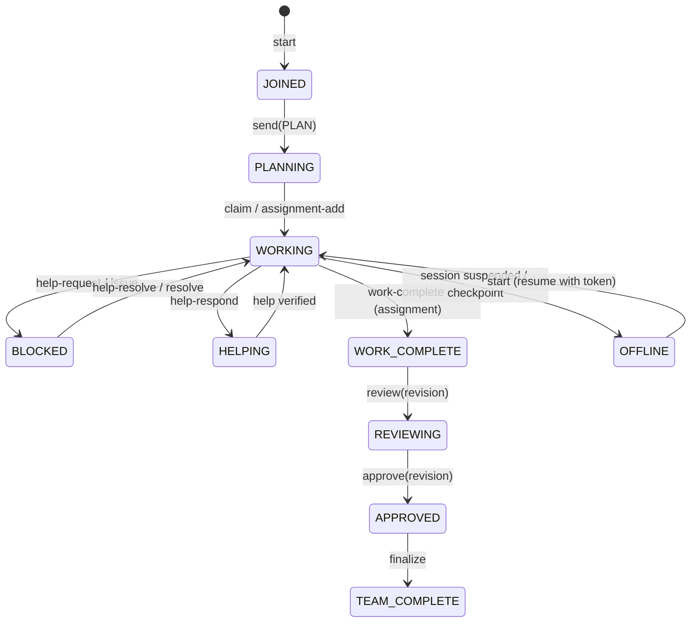

# COLLAB Protocol Specification (v1)

This document specifies the authoritative wire format, state transitions, message schemas, and coordination invariants implemented by COLLAB.

---

## 1. Event Log Format

The authoritative communication medium is `.collab/GROUP_CHAT.jsonl`.
- Each line is a valid UTF-8 JSON object ending with an exact LF (`\n`).
- Lines are append-only and immutable once written.
- Logical and chronological ordering is guaranteed by serialized WAL commits under exclusive file locks.

### 1.1 Event Schema

Every event object in `GROUP_CHAT.jsonl` contains the following fields:

```json
{
  "id": "msg-0192e4a8-6f10-7b22-83b4-52d19f4a91e0",
  "protocol_version": 1,
  "timestamp": "2026-10-14T07:15:00.123456Z",
  "agent_id": "agent-0192e4a8-6f02-7a8b-9801-443210abcedf",
  "agent_name": "Codex",
  "platform": "vscode",
  "model": "gpt-4o",
  "session_id": "sess-4a89bc21",
  "task_id": "task-0192e4a8-6f01-79cb-9876-123456789abc",
  "type": "PLAN",
  "content": "Inspecting AST parser implementation in src/parser.py",
  "recipient": null,
  "reply_to": null,
  "files": ["src/parser.py"],
  "evidence": []
}
```

### 1.2 Event Types

| Type | Semantics | Triggers State Transition |
| --- | --- | --- |
| `JOIN` | Emitted when an agent registers and enters the workspace. | Adds agent to task participants. |
| `PLAN` | Strategy or approach announcement. | Sets agent status to `PLANNING`. |
| `STATUS` | Status report or milestone update. | Updates agent `last_activity`. |
| `QUESTION` | Question addressed to the team or a specific peer. | None. |
| `REPLY` | Direct response to a question or peer message. | None. |
| `FINDING` | Factual discovery, bug, or performance metric. | Records finding in `state["tasks"][task_id]["findings"]`. |
| `SUGGESTION` | Proposal for alternative implementation or design. | None. |
| `HELP_REQUEST` | Blocked agent asking for peer assistance. | Creates an open help request in task state (blocks finalization). |
| `HELP_RESPONSE` | Peer offering a solution to a help request. | Updates help record with response. |
| `HELP_RESOLVED` | Requester confirming the issue has been resolved. | Marks help request `RESOLVED`. |
| `FILE_CHANGE` | Notification of edits made to project files. | None. |
| `ISSUE` | Blocker or defect identified during work. | Creates an issue in task state (`blocking: true` blocks finalization). |
| `ISSUE_RESOLVED` | Issue author confirming resolution. | Marks issue `RESOLVED`. |
| `REVIEW` | Independent review of a proposal revision. | Records review record (`APPROVE` or `REJECT`). |
| `DISAGREEMENT` | Formal disagreement with evidence. | Automatically creates a blocking issue. |
| `DECISION` | Collective decision or operator membership update. | Updates task decision state. |
| `APPROVAL` | Required member approval of an exact proposal revision. | Records approval for current proposal digest. |
| `REJECTION` | Member or reviewer rejection of proposal revision. | Blocks approval until revised. |
| `WORK_COMPLETE` | Agent finishing an individual assignment. | Marks assignment `WORK_COMPLETE` (does NOT complete task). |
| `TEAM_COMPLETE` | Guarded completion of the entire shared task. | Finalizes task to `TEAM_COMPLETE` and generates `FINAL_REPORT.md`. |

---

## 2. Agent Lifecycle State Machine



### The Cardinal Rule: Non-Preemptive Completion
When an agent finishes its owned assignments:
1. It transitions to `WORK_COMPLETE` on that assignment.
2. **The team task remains in progress.**
3. The finished agent remains available to answer questions, review peer proposals, run verification checks, and help unblock peers.

---

## 3. Proposal and Consensus Protocol

1. **Proposal Creation (`propose`)**:
   - Computes SHA-256 hashes of all project files declared in assignments, reservations, and modified artifacts.
   - Binds the active required participant list (`members`).
   - Assigns a sequential `revision` number and cryptographic `digest`:
     $$\text{digest} = \text{SHA-256}(\text{revision} \parallel \text{members} \parallel \text{file\_hashes} \parallel \text{content})$$
2. **Independent Review (`review`)**:
   - At least $N$ independent reviews (default: 1, author cannot review own proposal) with non-empty evidence.
   - Any `REJECT` verdict halts approval until a new proposal revision is published.
3. **Automated Verification Checks (`check`)**:
   - All pre-declared checks must be run against the exact proposal revision.
   - Exit codes must be 0, file hashes must match, and output logs must remain untampered on disk.
4. **Unanimous Member Approval (`approve`)**:
   - Every frozen member of the review round must sign off on the exact revision and digest.
   - Any external file modification or check failure automatically invalidates approvals.

---

## 4. Guarded Finalization Invariants

The `finalize` transition to `TEAM_COMPLETE` is atomic and enforced by the storage engine. It verifies all 9 invariants:
1. `required_assignments`: Every required assignment is `WORK_COMPLETE`.
2. `participant_results`: Every frozen member submitted a result.
3. `no_blocking_issues`: All issues are `RESOLVED`.
4. `no_unresolved_help`: All help requests are `RESOLVED`.
5. `independent_reviews`: Count of passing independent reviews $\ge \text{required}$.
6. `unanimous_approvals`: Every frozen member approved the active revision digest.
7. `passing_checks`: All pre-declared checks passed with intact evidence logs.
8. `unmodified_files`: Project file hashes match the proposal digest.
9. `no_active_reservations`: All file leases have been released.
