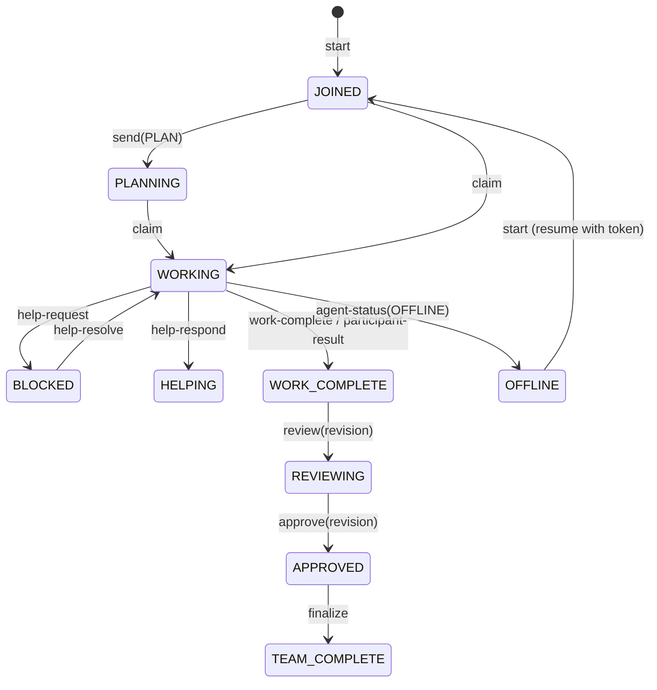

# COLLAB Protocol Specification (v1)

This document specifies the authoritative wire format, state transitions, message schemas, and coordination invariants implemented by COLLAB.

---

## 1. Event Log Format

The authoritative communication medium is `.collab/GROUP_CHAT.jsonl`.
- Each line is a valid UTF-8 JSON object ending with an exact LF (`\n`).
- Lines are append-only, hash-chained (`prev_hash` -> `hash`), and immutable once written.
- Logical and chronological ordering (`seq`) is guaranteed by serialized WAL commits under exclusive file locks.

### 1.1 Event Schema

Every event object in `GROUP_CHAT.jsonl` contains the following fields:

```json
{
  "seq": 2,
  "id": "msg_0192e4a86f107b2283b452d19f4a91e0",
  "protocol_version": 1,
  "timestamp": "2026-10-14T07:15:00.123Z",
  "agent_id": "agent_0192e4a86f027a8b9801443210abcedf",
  "agent_name": "Codex",
  "platform": "vscode",
  "model": "unknown",
  "session_id": "sess-4a89bc21",
  "task_id": "task_0192e4a86f0179cb9876123456789abc",
  "type": "PLAN",
  "content": "Inspecting AST parser implementation in src/parser.py",
  "recipient": null,
  "reply_to": null,
  "files": ["src/parser.py"],
  "evidence": [],
  "prev_hash": "6b86b273ff34fce19d6b804eff5a3f5747ada4eaa22f1d49c01e52ddb7875b4b",
  "state_hash": "d4735e3a265e16eee03f59718b9b5d03019c07d8b6c51f90da3a666eec13ab35",
  "hash": "4e07408562bedb8b60ce05c1decfe3ad16b72230967de01f640b7e4729b49fce"
}
```

### 1.2 Event Types (`TYPES`)

| Type | Emitted By | Semantics & State Transition |
| --- | --- | --- |
| `JOIN` | `start` (new member) | Emitted when an agent registers and joins a task. |
| `PLAN` | `send(PLAN)`, `assignment-add`, `reserve` | Strategy announcement, assignment creation, or file reservation. Sets `JOINED` agent to `PLANNING`. |
| `STATUS` | `send(STATUS)`, `start` (resume), `claim`, `progress`, `release`, `checkpoint`, `agent-status`, `check` (pass) | Status report, progress update, or passing check run. |
| `QUESTION` | `send(QUESTION)` | Question addressed to the team or a specific peer. |
| `REPLY` | `send(REPLY)` | Direct response to a question or peer message. |
| `FINDING` | `finding`, `send(FINDING)` | Factual discovery, bug, or metric saved in task state and `.collab/findings/`. |
| `SUGGESTION` | `send(SUGGESTION)` | Proposal for alternative implementation or design. |
| `HELP_REQUEST` | `help-request`, `send(HELP_REQUEST)` | Blocked agent asking for peer assistance (blocks finalization; sets status to `BLOCKED`). |
| `HELP_RESPONSE` | `help-respond`, `send(HELP_RESPONSE)` | Peer offering a solution to a help request (sets responder status to `HELPING`). |
| `FILE_CHANGE` | `file-write`, `file-record`, `send(FILE_CHANGE)` | Notification of hash-verified edits made to project files. |
| `ISSUE` | `issue`, `check` (fail), `send(ISSUE)` | Blocker or defect identified during work (`blocking: true` blocks finalization). |
| `REVIEW` | `review(APPROVE)`, `send(REVIEW)` | Independent review approving a proposal revision with evidence. |
| `REJECTION` | `review(REJECT)`, `send(REJECTION)` | Independent review rejecting a proposal revision (clears approvals until revised). |
| `DISAGREEMENT` | `send(DISAGREEMENT)` | Formal disagreement with evidence (automatically creates a blocking issue and invalidates review). |
| `DECISION` | `propose`, `help-resolve`, `resolve`, `collab_operator.py` | Proposal revision creation, blocker/help resolution confirmation, or operator membership update. |
| `APPROVAL` | `approve` | Frozen member sign-off bound to the exact proposal revision and digest. |
| `WORK_COMPLETE` | `work-complete`, `participant-result` | Agent finishing an individual assignment or submitting participant results (never completes team task). |
| `TEAM_COMPLETE` | `finalize` | Guarded completion of the entire shared task and generation of `FINAL_REPORT.md`. |

---

## 2. Agent Lifecycle State Machine



### The Cardinal Rule: Non-Preemptive Completion
When an agent finishes its owned assignments:
1. It transitions to `WORK_COMPLETE` on that assignment.
2. **The team task remains open (`WORKING`, `PENDING`, or `REVIEW`).**
3. The finished agent remains available to answer questions, review peer proposals, run verification checks, and help unblock peers.

---

## 3. Proposal and Consensus Protocol

1. **Proposal Creation (`propose`)**:
   - Computes SHA-256 hashes of all project files declared in assignments, proposals, required artifacts, and recorded changes.
   - Binds the active required participant list (`members`).
   - Assigns a sequential `revision` number and cryptographic `digest` over the proposal content, file hashes, revision, members, limitations, criteria, assignments, issues, findings, participant results, and checks.
2. **Independent Review (`review`)**:
   - At least $N$ independent reviews (default: 1; proposal author cannot satisfy independent review for their own proposal) with non-empty evidence.
   - Any `REJECT` verdict clears approvals and blocks finalization until resolved or superseded by a new proposal revision.
3. **Automated Verification Checks (`check`)**:
   - All pre-declared checks must be run against the exact proposal revision and digest.
   - Exit codes must be `0`, file hashes must remain unchanged, and output logs (`.collab/checkpoints/<check_id>.log`) must match their recorded `log_hash` on disk.
4. **Unanimous Member Approval (`approve`)**:
   - Every frozen member of the review round (`decision.members`) must sign off on the exact revision and digest.
   - Any material state mutation, file change, or check failure automatically invalidates approvals.

---

## 4. Guarded Finalization Invariants

The `finalize` transition to `TEAM_COMPLETE` is atomic and enforced by `engine.py:readiness`. It verifies all 9 gates:
1. `required_assignments`: At least one required assignment exists and every required assignment is `WORK_COMPLETE`.
2. `participant_results`: Every frozen member in `decision.members` submitted a result.
3. `no_open_blockers`: All blocking issues (`blocking: true`) and all help requests are `RESOLVED`.
4. `independent_reviews`: At least `independent_reviews` non-author `APPROVE` reviews with non-empty evidence exist for the active revision, and zero unresolved `REJECT` reviews exist on the active revision.
5. `unanimous_approvals`: Every frozen member approved the active revision and exact digest.
6. `passing_checks`: All pre-declared checks passed (`returncode == 0`) on the active revision/digest and their evidence log files match `log_hash` on disk.
7. `unmodified_files`: All tracked project file hashes match `decision.file_hashes`.
8. `required_artifacts`: All required artifact files declared in `start` or `propose` exist on disk.
9. `no_active_reservations`: All file reservations for the task have been released.

## Schema 2: cross-IDE gates (beta.2)

Tasks carry `project_root` and `team_requirements` (`expected_platforms`,
`min_distinct_platforms`). Platform aliases normalize to families separately from
exact identity metadata; two Codex sessions are one platform. Required late joins
invalidate REVIEW, clear approvals, and enter WORKING with expanded mandatory
membership. A new proposal and fresh checks/reviews/approvals are required.
Unrelated late observers remain supported. Membership snapshots cannot omit a
currently required participant at finalization.

A `checkpoint` with `pending: true` changes an unfinished task to PENDING, the
caller to PAUSED, and invalidates review. `start` resumes that caller's presence;
normal work or a new proposal advances the task. A checkpoint records missing
collaborators and next steps without asserting a paused session is active.

Migration is additive on the next successful locked mutation; event protocol v1
and historical hashes remain unchanged. Bound state copied to another root is
refused even during WAL recovery. See [command reference](../skills/collab/references/commands.md#identity-and-schema-compatibility)
for identity sources, legacy-root limitations, and mixed-version restrictions.
